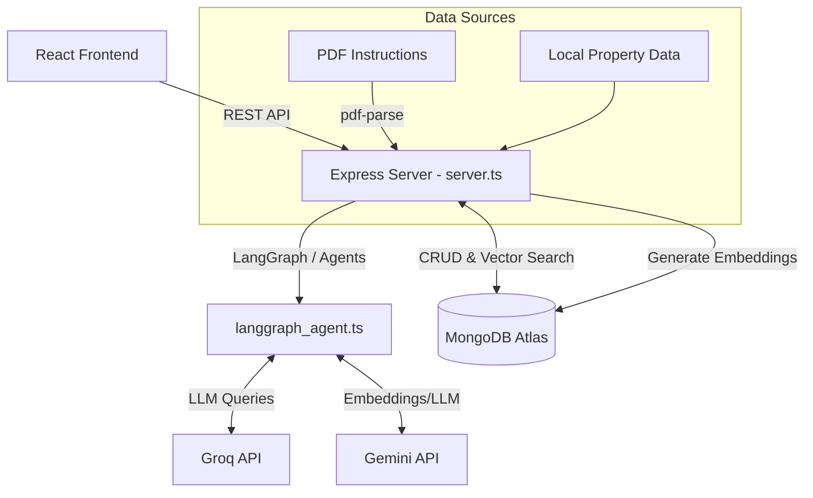

# Lyka Realty Agentic AI CRM - Project Overview

Based on exploring the `project2` directory, here is an overview of the application's architecture, tech stack, and key features. 

## 🛠️ Technology Stack

**Frontend:**
- React 19
- Vite for building and development
- TailwindCSS v4 for styling
- Lucide React for icons
- Framer Motion for animations

**Backend / API:**
- Node.js & Express
- LangGraph (`@langchain/langgraph`) & LangChain Core for agentic workflows
- TSX / ESBuild for TypeScript execution and bundling

**AI & Database Integration:**
- **Google Gemini AI** (`@google/genai`) for text generation and embeddings
- **Groq** (`groq-sdk`) for fast LLM inference (e.g., Llama 3.3 70b)
- **MongoDB** for vector embedding persistence and data storage (`customer_embeddings`, `leads`, `followups`, `pdf_knowledge_embeddings`, `property_embeddings`)
- **pdf-parse** for reading and chunking PDF documents for RAG (Retrieval-Augmented Generation)
- **Firebase** (configured but possibly for auth/hosting based on the blueprint files)

## 🏗️ Architecture Summary

## 🧠 Key Agentic Features (from `server.ts`)

1. **Hybrid Vector Search**: Uses Gemini (or a deterministic fallback) to generate numerical embeddings for text (customer queries, property data, and PDF knowledge).
2. **MongoDB Vector Persistence**: Connects to MongoDB to store and retrieve vectors. Features a resilient boot sequence that falls back to in-memory storage if MongoDB is unavailable.
3. **RAG (Retrieval-Augmented Generation)**: Automatically parses `Real_Estate_Lead_Qualification_Agent_Instructions_v2.pdf` to chunk into sections, generates embeddings, and injects them into the LangGraph agent alongside property listings.
4. **CRM Sync**: Syncs Leads and Follow-ups directly to MongoDB collections, enabling a robust AI-powered real estate CRM.

> [!TIP]
> This structure is ready for development! If you want to dive into specific parts, like modifying the LangGraph agent in `langgraph_agent.ts` or tweaking the React frontend in `src/App.tsx`, let me know what we should work on next!
